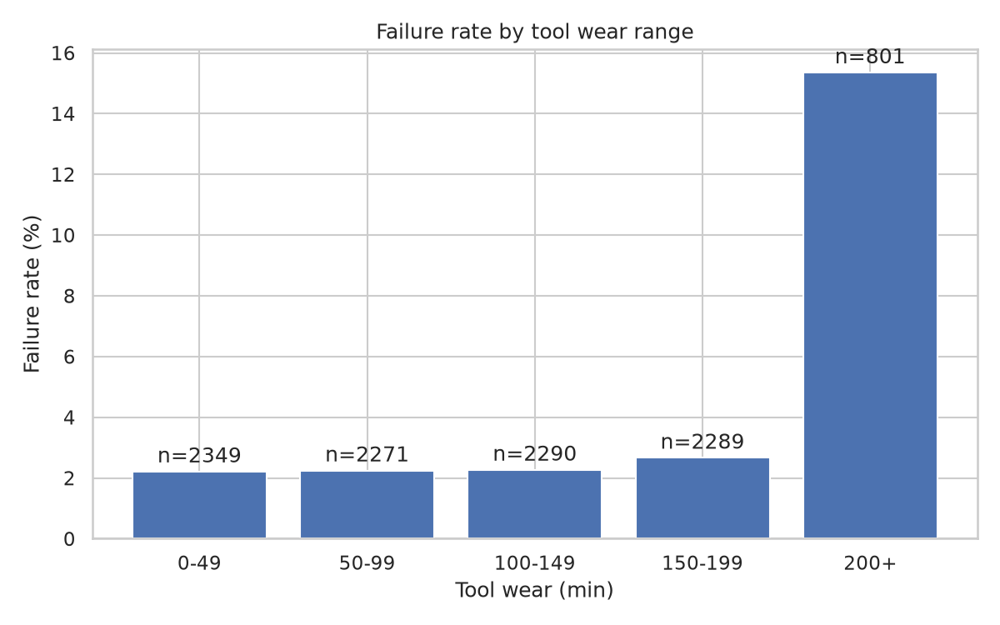
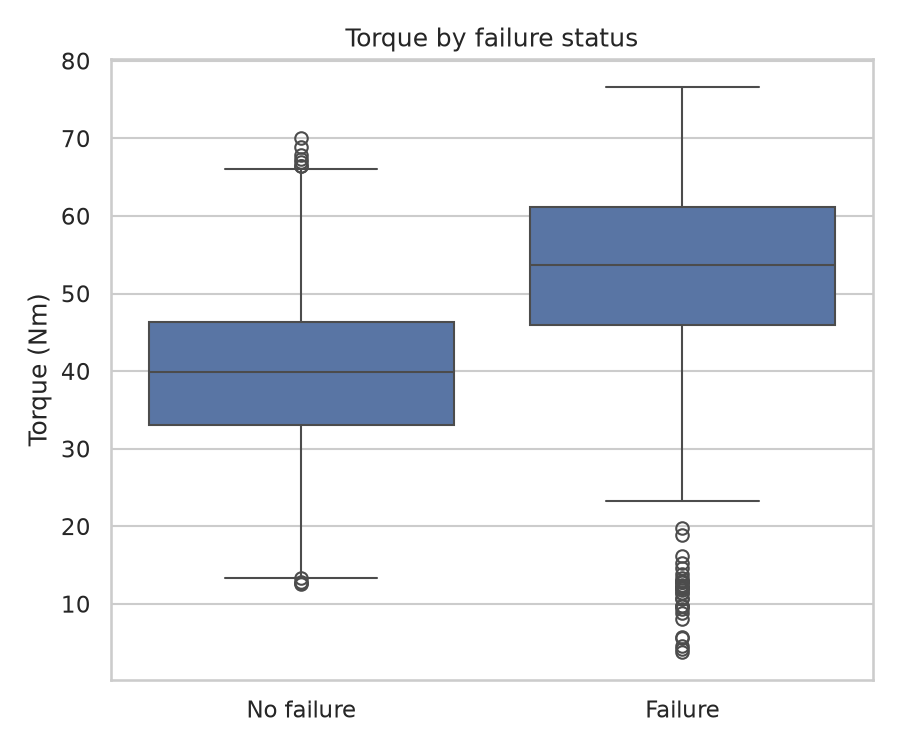
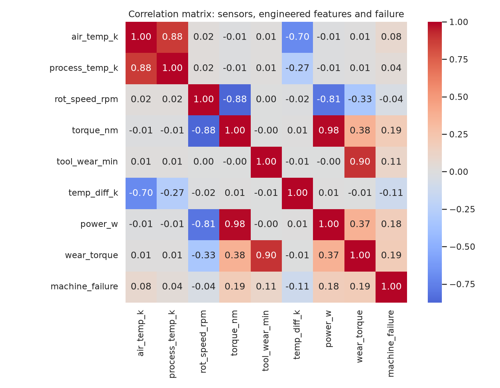
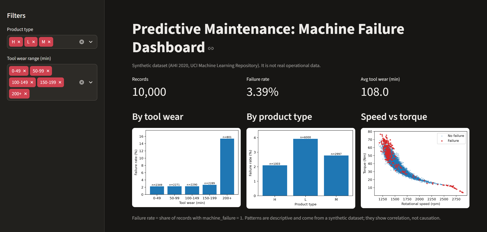

# Predictive Maintenance: Machine Failure Analysis

An end-to-end data project: exploring sensor data from industrial machines, querying it with SQL,
building a baseline failure-prediction model for an imbalanced problem, and presenting results in a Streamlit dashboard.

> Learning project using a public **synthetic** dataset. It does not use real operational data.

## Business question
Which operating conditions are associated with machine failures, and how could a maintenance team prioritise inspections?

## Data
- Source: AI4I 2020 Predictive Maintenance Dataset (UCI Machine Learning Repository), licensed under CC BY 4.0. See `data/README.md` for download instructions and the citation.
- Synthetic data: 10,000 records and 14 columns, with no missing values. Sensor readings: air and process temperature (K), rotational speed (rpm), torque (Nm) and tool wear (min), plus product type (L, M, H). Target: `Machine failure` (339 failures, 3.39%).

## Approach
1. **Cleaning & EDA** (pandas, matplotlib, seaborn) in `notebooks/01_eda.ipynb`: distributions, failed vs normal records, correlations.
2. **Feature engineering:** three features built only from sensor readings, motivated by the dataset description: temperature difference (process minus air), power (torque x angular speed) and tool wear x torque.
3. **SQL analysis** (SQLite): 5 operational queries in `sql/queries.sql`.
4. **Modelling** (scikit-learn): Logistic Regression baseline and Random Forest. Class imbalance is handled with a stratified 80/20 split (`random_state=42`) and `class_weight='balanced'`.
5. **Dashboard** (Streamlit): KPIs, two filters and three charts.

## Avoiding data leakage
The five failure-mode columns (TWF, HDF, PWF, OSF, RNF) define the target directly: 330 of the 339 failures have at least one mode flagged. A model that sees them would look excellent without predicting anything, and in practice the failure mode is not known before the failure happens. They are excluded from the features, together with the identifier columns (`UDI`, `Product ID`), and `train_model.py` stops with an error if any of them enters the feature list.

27 records do not match the failure-mode columns: 18 have RNF flagged but no failure, and 9 are failures with no mode flagged. The target column was left unchanged.

## Key findings
(All numbers come from my own runs on this synthetic dataset.)
- **Tool wear behaves like a threshold.** The failure rate stays between 2.21% and 2.66% below 200 minutes of wear, then rises to 15.36% at 200+ minutes (801 records, 123 failures).
- **Product type.** Failure rates: L 3.92% (6,000 records), M 2.77% (2,997), H 2.09% (1,003). H has only 21 failures, so its rate rests on few events.
- **Combined condition.** Records with above-average torque and at least 200 minutes of tool wear: 408 records, 93 failures, a 22.79% failure rate. The 200-minute cut-off was chosen after looking at the data.
- **Torque.** Mean torque is higher for failures (50.17 Nm) than for normal records (39.63 Nm).
- **Linear correlations with failure are weak** (the highest is 0.19, for torque), so linear correlation alone understates some patterns such as the wear threshold.
- **What the Random Forest relies on most** (permutation importance on the test set, drop in PR-AUC when a feature is shuffled): rotational speed (0.380), temperature difference (0.253), wear x torque (0.144), power (0.105). Several features are correlated with each other, so individual values are shared between them.

## Model results
Test set: 2,000 records, 68 failures. Decision threshold: 0.5.

| Model | Precision | Recall | F1 | PR-AUC | ROC-AUC |
|---|---|---|---|---|---|
| Logistic Regression | 0.179 | 0.882 | 0.298 | 0.430 | 0.939 |
| Random Forest | 0.663 | 0.868 | 0.752 | 0.865 | 0.980 |

| Model | True negatives | False positives | False negatives | True positives |
|---|---|---|---|---|
| Logistic Regression | 1657 | 275 | 8 | 60 |
| Random Forest | 1902 | 30 | 9 | 59 |

Recall on failures is emphasised because a missed failure is usually costlier than a false alarm. Accuracy is not used as the main metric: always predicting "no failure" would reach about 96.6% accuracy on this test set while catching no failure at all. For reference, a random model would have a PR-AUC of about 0.034 (the failure rate).

Both models catch a similar number of failures (60 and 59 of 68), but Logistic Regression raises 335 alerts and Random Forest 89.

## Recommendations (illustrative)
- Consider inspecting or replacing tools before they reach about 200 minutes of wear, starting with product type L, where the failure rate at 200+ minutes was highest in this data (18.29%).
- Look at rotational speed, temperature difference and torque together rather than one reading at a time, since the model relied most on these.
- If a model is used to rank inspections, choose the decision threshold from real inspection and failure costs. No cost estimates were made here.

## Limitations
- Synthetic dataset: patterns may differ from real operational data, and the model scores are likely optimistic for real data (not tested here).
- A single train/test split with only 68 failures in the test set: no cross-validation, so the metrics may vary with a different split.
- Basic preprocessing and no hyperparameter tuning; the default 0.5 threshold was not tuned.
- Correlated features (for example torque and power) make individual importance values hard to interpret.
- Correlation, not causation.
- 27 records (0.27%) where the target does not match the failure-mode columns.
- No time-series modelling.

## How to run
```bash
git clone <repo-url>
cd predictive-maintenance-analysis
python -m venv .venv && source .venv/bin/activate   # Windows: .venv\Scripts\activate
pip install -r requirements.txt
# download the dataset as described in data/README.md
python src/load_to_sqlite.py
python src/run_sql.py          # optional: prints the SQL query results
python src/train_model.py
streamlit run app/dashboard.py
```
Developed with Python 3.14.

## Repository structure
```
README.md
requirements.txt
data/README.md          # data source, license, how to place the CSV
notebooks/01_eda.ipynb
sql/queries.sql
src/load_to_sqlite.py
src/run_sql.py
src/train_model.py
app/dashboard.py
reports/figures/
models/
```

## Tech stack
Python, pandas, NumPy, scikit-learn, matplotlib, seaborn, SQLite/SQL, Streamlit, Git/GitHub

## Screenshots



